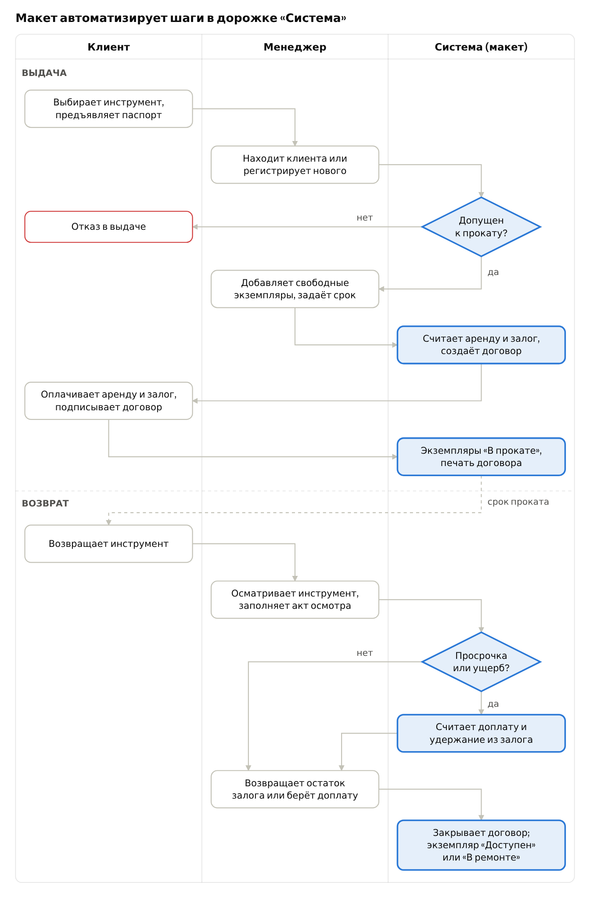

# ТЕРМИНЫ И ОПРЕДЕЛЕНИЯ

Table: Термины и определения
| Термин | Определение |
| --- | --- |
| АИС | Автоматизированная информационная система — совокупность ПО, данных и персонала, автоматизирующая учёт и операции пункта проката. |
| Макет системы | Работающая упрощённая версия АИС с интерфейсом, реализующая часть функций (один бизнес-процесс) для демонстрации. |
| Прокат (аренда) | Временная передача инструмента клиенту за плату на оговорённый срок. |
| Пункт проката | Точка выдачи и приёма инструмента; объект автоматизации. |
| Клиент (арендатор) | Физическое или юридическое лицо, берущее инструмент в прокат. |
| Менеджер пункта проката | Сотрудник, оформляющий выдачу, приём и оплату; основной пользователь АИС. |
| Администратор | Сотрудник, ведущий справочники (каталог, тарифы, сотрудники) и просматривающий отчёты. |
| Модель инструмента | Позиция каталога: наименование, категория, характеристики, тариф (например, «Перфоратор Makita HR2470»). |
| Экземпляр инструмента | Конкретный физический предмет модели с инвентарным номером и состоянием. |
| Инвентарный номер | Уникальный код экземпляра (штрихкод/QR) для учёта. |
| Тариф | Стоимость проката модели за период (сутки, выходные, неделя). |
| Залог | Денежная сумма или документ, оставляемые клиентом в обеспечение возврата; возвращается при сдаче исправного инструмента. |
| Договор проката | Документ, фиксирующий клиента, экземпляры, срок, стоимость и залог; основание выдачи. |
| Бронирование | Резервирование экземпляра на будущую дату без выдачи. |
| Выдача | Передача экземпляра клиенту по договору; статус экземпляра меняется на «В прокате». |
| Возврат (приём) | Приём экземпляра от клиента с осмотром, расчётом итоговой суммы и закрытием договора. |
| Просрочка | Возврат позже даты окончания договора; влечёт доплату по тарифу или штраф. |
| Акт осмотра (дефектовка) | Запись о состоянии инструмента при выдаче и возврате; основание удержания из залога. |
| Статус экземпляра | Состояние в учёте: «Доступен», «Забронирован», «В прокате», «В ремонте», «Списан». |
| BPMN | Business Process Model and Notation — нотация моделирования бизнес-процессов (используется в лабораторной работе 2). |
| ER-диаграмма | Диаграмма «сущность–связь», описывающая структуру базы данных (лабораторная работа 3). |
| СУБД | Система управления базами данных. |

# ОБЗОР ПРЕДМЕТНОЙ ОБЛАСТИ И АНАЛОГОВ

Готовые системы проката решают одну и ту же задачу — учёт доступности каждого экземпляра и оформление выдачи и возврата, но стоят от 850 ₽ до 499 $ в месяц и избыточны для малого пункта. Макет берёт их ядро: каталог со статусами, договор, залог, расчёт просрочки.

## Как работает пункт проката инструментов

Пункт сдаёт в аренду электро- и бензоинструмент (перфораторы, болгарки, шуруповёрты, катки, генераторы, строительные леса) частным лицам и бригадам. Клиент выбирает инструмент, предъявляет паспорт, вносит залог и оплату за срок, подписывает договор. При возврате менеджер осматривает инструмент, начисляет доплату за просрочку или повреждения и возвращает залог.

Типичные проблемы при бумажном или Excel-учёте:

- непонятно, какие экземпляры свободны сейчас и на нужную дату, — возникают двойные брони;
- договор заполняется вручную, оформление занимает время, возможны ошибки в суммах;
- просрочки не отслеживаются автоматически;
- нет истории клиента (надёжный / в чёрном списке) и истории ремонтов экземпляра;
- нет отчётов по выручке и востребованности моделей.

## Сравнение аналогов

Table: Сравнение систем учёта проката
| Система | Тип | Цена | Бронирование | Залоги | Штрихкоды | Ремонт | Онлайн-витрина |
| --- | --- | --- | --- | --- | --- | --- | --- |
| [Rent in Hand](https://rentinhand.ru/programma-dlya-ucheta-prokata-instrumenta) (РФ) | Облако + iOS/Android | от 850 ₽/мес | Да, виджет и ВК | Да | Не указано | Да | Виджет |
| [Класс365](https://class365.ru/resheniya/uchet-prokata-ili-arendy/) (РФ) | Облако: CRM, склад, касса | По запросу | Заявки и статусы | Не указано | Не указано | Нет | Нет |
| [Booqable](https://booqable.com/tool-rental-software/) | Облако + iOS/Android | от 29 $/мес | Да, защита от двойной брони | Да, сумма или % | Да | Не указано | Да |
| [EZRentOut](https://www.capterra.com/p/134914/EZRentOut/) | Облако + мобильное приложение | от 399 $/мес | Да, календарь | Не указано | Да, QR/RFID | Да, плановое ТО | Да |
| Журнал / Excel | Ручной учёт | 0 ₽ | Нет | Вручную | Нет | Нет | Нет |

## Выводы по обзору

1. Все аналоги строятся вокруг статуса экземпляра и договора проката — это и есть ядро, которое реализует макет.
2. Залог, тариф за период и доплата за просрочку — специфика проката, которой нет в обычных CRM; её нужно считать автоматически.
3. Онлайн-витрина, мобильные приложения, интеграция с кассами и RFID — за рамками макета; они указаны в ТЗ как развитие системы.
4. Собственная АИС оправдана для малого пункта (1–3 сотрудника, до 500 экземпляров): без абонплаты, данные хранятся локально, интерфейс под один процесс.

Данные с сайтов разработчиков и Capterra на 2 октября 2026 г.

# 1 Общие сведения

ТЗ оформлено по структуре ГОСТ 34.602-2020 «Техническое задание на создание автоматизированной системы» в сокращённом для учебного проекта виде.

## 1.1 Наименование системы

- Полное наименование: Автоматизированная информационная система учёта проката инструментов.
- Краткое наименование: АИС «Прокат инструментов» (далее — Система).
- Предмет разработки: макет Системы с реализацией бизнес-процесса «Выдача и возврат инструмента».

## 1.2 Заказчик и разработчик

- Заказчик: кафедра [название кафедры], преподаватель [ФИО] (условно — пункт проката инструментов).
- Разработчики: студенты группы [номер] [ФИО 1], [ФИО 2].

## 1.3 Основание для разработки

Учебный план дисциплины «Введение в программную инженерию», задание на лабораторные работы, вариант «Прокат инструментов».

## 1.4 Сроки

- Начало работ: [дата выдачи задания].
- Окончание работ: [дата защиты последней лабораторной работы].

## 1.5 Порядок оформления и предъявления результатов

Результаты каждого этапа предъявляются на лабораторном занятии в виде отчёта (электронно или на бумаге) с устной защитой. Макет предъявляется демонстрацией на ноутбуке разработчика и исходным кодом.

# 2 Назначение и цели создания системы

## 2.1 Назначение

Система предназначена для автоматизации работы пункта проката: ведения каталога инструментов и базы клиентов, оформления договоров выдачи и возврата, расчёта стоимости и залога, контроля просрочек и получения отчётов.

Система используется сотрудниками пункта (менеджер, администратор) на рабочем месте стойки выдачи.

## 2.2 Цели создания

Table: Цели создания Системы
| Цель | Критерий достижения |
| --- | --- |
| Сократить время оформления выдачи | Договор оформляется не более чем за 3 минуты для клиента из базы |
| Исключить выдачу занятого или неисправного инструмента | В договор можно добавить только экземпляр со статусом «Доступен» |
| Исключить ошибки в расчётах | Стоимость, залог и доплата за просрочку считаются автоматически по тарифу |
| Контролировать сроки возврата | Список просроченных договоров виден на главном экране |
| Хранить историю клиентов и экземпляров | Для любого клиента и экземпляра доступен список договоров |
| Получать управленческую информацию | Отчёт по выручке и загрузке инструмента за период |

# 3 Характеристика объекта автоматизации

## 3.1 Объект автоматизации

Объект — пункт проката строительного и садового инструмента с одной точкой выдачи. Для проектирования приняты допущения:

- штат: 1–3 сотрудника, работа в одну смену;
- парк: до 500 экземпляров и до 150 моделей в 10–15 категориях;
- нагрузка: до 50 выдач и возвратов в день;
- срок проката: от 1 суток до 30 дней, оплата вперёд за весь срок.

## 3.2 Роли пользователей

Table: Роли пользователей
| Роль | Что делает в Системе | Работает в Системе |
| --- | --- | --- |
| Менеджер пункта | Регистрирует клиентов, оформляет выдачу и возврат, принимает оплату, смотрит просрочки | Да |
| Администратор | Всё, что менеджер, плюс каталог, тарифы, списание, сотрудники, отчёты | Да |
| Клиент | Выбирает инструмент, предъявляет документ, платит, получает и возвращает инструмент | Нет (в макете нет личного кабинета) |
| Мастер по ремонту | Принимает неисправный инструмент, возвращает его в статус «Доступен» | Роль администратора в макете |

## 3.3 Автоматизируемый бизнес-процесс

В макете реализуется процесс «Выдача и возврат инструмента» — основной и самый частый процесс пункта; именно он моделируется в BPMN в лабораторной работе 2. Схема процесса по участникам приведена на рисунке 1; выделенные шаги программирует макет, остальное выполняют люди.

Расчёт сумм при возврате: итог = оплаченная аренда + дни просрочки × суточный тариф × 1,5 + ущерб по акту осмотра. Доплата и ущерб удерживаются из залога; если залога не хватает, клиент доплачивает разницу. Коэффициент 1,5 — параметр, задаваемый администратором.

Другие процессы пункта (бронирование, ремонт, закупка и списание, отчётность) описаны в разделе 4 как функции полной Системы.

# 4 Требования к системе

Полная Система состоит из шести подсистем; макет реализует три из них целиком, а справочники — в объёме, нужном для выдачи и возврата.

## 4.1 Требования к функциям

Table: Функции Системы
| № | Подсистема | Функция | В макете |
| --- | --- | --- | --- |
| Ф-1 | Авторизация | Вход по логину и паролю, разграничение прав «Менеджер» / «Администратор» | Да |
| Ф-2 | Каталог | Просмотр и поиск моделей по названию и категории с числом свободных экземпляров | Да |
| Ф-3 | Каталог | Добавление и редактирование категорий, моделей, тарифов и залогов | Частично (данные загружаются скриптом) |
| Ф-4 | Каталог | Учёт экземпляров: инвентарный номер, статус, история договоров | Да |
| Ф-5 | Клиенты | Регистрация клиента (ФИО, телефон, документ), поиск по телефону и ФИО | Да |
| Ф-6 | Клиенты | История прокатов клиента, отметка «чёрный список» с запретом выдачи | Да |
| Ф-7 | Прокат | Оформление договора выдачи: клиент, один или несколько свободных экземпляров, срок, авторасчёт стоимости и залога | Да |
| Ф-8 | Прокат | Печатная форма договора (HTML-страница для печати) | Да |
| Ф-9 | Прокат | Оформление возврата: осмотр, расчёт просрочки и ущерба, возврат залога, закрытие договора | Да |
| Ф-10 | Прокат | Продление срока договора с доплатой | Нет |
| Ф-11 | Прокат | Главный экран: выдано сегодня, к возврату сегодня, просроченные договоры | Да |
| Ф-12 | Бронирование | Резервирование экземпляра на дату с проверкой пересечений | Нет |
| Ф-13 | Обслуживание | Передача в ремонт и возврат из ремонта, списание экземпляра | Частично (смена статуса) |
| Ф-14 | Отчёты | Выручка за период, самые востребованные модели, загрузка парка | Нет |

## 4.2 Требования к информационному обеспечению

Данные хранятся в реляционной БД. Перечень сущностей — основа ER-диаграммы в лабораторной работе 3.

Table: Сущности базы данных
| Сущность | Ключевые атрибуты | Связи |
| --- | --- | --- |
| Категория | код, название | 1 : N Модель |
| Модель инструмента | код, название, производитель, характеристики, тариф за сутки, сумма залога | 1 : N Экземпляр |
| Экземпляр | инвентарный номер, статус, дата покупки, примечание | N : M Договор (через Позицию) |
| Клиент | код, ФИО, телефон, серия и номер документа, признак чёрного списка | 1 : N Договор |
| Сотрудник | код, ФИО, логин, хэш пароля, роль | 1 : N Договор |
| Договор проката | номер, дата выдачи, плановая и фактическая дата возврата, статус, сумма аренды, сумма залога, итог | 1 : N Позиция, 1 : N Платёж |
| Позиция договора | экземпляр, тариф на момент выдачи, состояние при выдаче и возврате, сумма ущерба | — |
| Платёж | дата, вид (аренда / залог / возврат залога / доплата), способ, сумма | — |

Целостность данных: экземпляр не может входить в два открытых договора одновременно; дата возврата не раньше даты выдачи; удаление клиента или экземпляра с договорами запрещено (только списание / архив).

## 4.3 Требования к интерфейсу

- Веб-интерфейс на русском языке, корректно отображается при ширине окна от 1280 px.
- Экраны макета: вход; главная панель; каталог; клиенты; новая выдача; возврат; карточка договора с печатной формой.
- Оформление выдачи — не более 3 шагов: клиент → инструменты и срок → подтверждение.
- Ошибки ввода показываются рядом с полем; необратимые действия (закрытие договора, списание) требуют подтверждения.
- Статусы выделяются цветом и текстом: просроченные договоры — красным.

## 4.4 Требования к надёжности и безопасности

- Пароли хранятся только в виде хэша; без входа страницы Системы недоступны.
- Функции администратора недоступны роли «Менеджер».
- Персональные данные клиентов обрабатываются с учётом 152-ФЗ; в макете используются только вымышленные данные.
- Операции выдачи и возврата выполняются в одной транзакции БД: при ошибке статусы не меняются.
- Резервное копирование — копирование файла БД (в полной Системе — ежедневно).

## 4.5 Требования к программному и техническому обеспечению

Архитектура — веб-приложение «клиент–сервер»: сервер и БД на одном компьютере пункта, доступ через браузер.

Table: Выбор программных средств
| Компонент | Выбор | Обоснование |
| --- | --- | --- |
| Язык | Python 3.12 | Бесплатный, кроссплатформенный, изучен командой, быстрая разработка макета |
| Веб-фреймворк | Flask 3 + шаблоны Jinja2 | Минимальный объём кода, не навязывает структуру; Django избыточен для 7 экранов |
| СУБД | SQLite 3 | БД — один файл, не требует сервера и настройки, встроена в Python, поддерживает SQL и транзакции; для 1–3 рабочих мест производительности достаточно. При росте — переход на PostgreSQL |
| Интерфейс | HTML + Bootstrap 5 | Готовые таблицы, формы и стили без собственного CSS |
| BPMN-диаграмма | draw.io (diagrams.net) или bpmn.io | Бесплатно, работает в браузере, есть набор элементов BPMN 2.0 |
| ER-диаграмма | draw.io или dbdiagram.io | Бесплатно; dbdiagram строит диаграмму из текста и экспортирует SQL |
| Среда разработки и хранение кода | VS Code / PyCharm, Git + GitHub | Совместная работа двух разработчиков, история изменений |

Техническое обеспечение: ПК или ноутбук с Windows 10+, macOS 12+ или Linux, 4 ГБ ОЗУ, 200 МБ свободного места, современный браузер (Chrome, Firefox, Edge, Safari); принтер — для печати договора. Интернет для работы не нужен.

## 4.6 Перспективы развития

По итогам обзора аналогов: онлайн-бронирование с сайта, сканирование штрихкодов инвентарных номеров, SMS-напоминания о возврате, интеграция с онлайн-кассой (54-ФЗ), несколько точек выдачи.

# 5 Состав и содержание работ

Работа выполняется в пять этапов, совпадающих с лабораторными работами; максимум — 40 баллов за работы плюс 10 за посещение лекций.

Table: Этапы работ
| Этап | Содержание | Результат | Баллы |
| --- | --- | --- | --- |
| 1 ТЗ (ЛР 1) | Обзор предметной области и аналогов, глоссарий, требования | Настоящее ТЗ | 7 |
| 2 Модель процесса (ЛР 2) | BPMN-диаграмма процесса «Выдача и возврат инструмента» с дорожками участников и описание | Диаграмма и пояснительная записка | 8 |
| 3 Модель данных (ЛР 3) | ER-диаграмма по сущностям п. 4.2, скрипт создания БД | Диаграмма и SQL-скрипт | 5 |
| 4 Разработка макета | Программирование функций с отметкой «Да» в п. 4.1, тестовые данные | Исходный код, работающий макет | 10 (демонстрация) |
| 5 Документация (ЛР 4) | Описание программы и руководство пользователя | Два документа | 5 + 5 |

# 6 Порядок контроля и приёмки

Макет принимается, если на демонстрации успешно выполнены все сценарии:

1. Вход менеджером; попытка входа с неверным паролем отклоняется.
2. Регистрация нового клиента и поиск его по телефону.
3. Выдача двух инструментов на 3 суток: сумма и залог совпадают с ручным расчётом, статусы стали «В прокате», договор выводится на печать.
4. Экземпляр «В прокате» или «В ремонте» нельзя добавить в новый договор; клиенту из чёрного списка выдача запрещена.
5. Возврат в срок без повреждений: залог возвращён полностью, экземпляры «Доступен».
6. Возврат с просрочкой 2 дня и повреждением: доплата и удержание из залога рассчитаны по формуле п. 3.3, экземпляр «В ремонте».
7. Просроченный договор виден на главном экране и выделен.

Тестовая БД для демонстрации: не менее 5 категорий, 15 моделей, 30 экземпляров, 10 клиентов, 1 просроченный договор.

# 7 Требования к документированию

Table: Состав документации
| Документ | Ориентир по стандарту |
| --- | --- |
| Техническое задание | ГОСТ 34.602-2020 |
| Описание бизнес-процесса | Нотация BPMN 2.0 |
| ER-диаграмма | Нотация Чена или Crow's Foot |
| Описание программы | ГОСТ 19.402-78 |
| Руководство пользователя | РД 50-34.698-90, п. 3.4 |

Отчёты оформляются по ГОСТ 7.32-2017: шрифт Times New Roman 14, межстрочный интервал 1,5, поля 30/15/20/20 мм, нумерация страниц внизу по центру.

# 8 Источники разработки

1. ГОСТ 34.602-2020. Информационные технологии. Комплекс стандартов на автоматизированные системы. Техническое задание на создание автоматизированной системы.
2. ГОСТ 34.003-90. Информационная технология. Комплекс стандартов на автоматизированные системы. Автоматизированные системы. Термины и определения.
3. ГОСТ 7.32-2017. Отчёт о научно-исследовательской работе. Структура и правила оформления.
4. Федеральный закон от 27.07.2006 № 152-ФЗ «О персональных данных».
5. Гражданский кодекс Российской Федерации, часть вторая, ст. 626–631 (договор проката).
6. [Rent in Hand — программа для учёта проката инструмента](https://rentinhand.ru/programma-dlya-ucheta-prokata-instrumenta) (дата обращения: 02.10.2026).
7. [Класс365 — учёт проката или аренды](https://class365.ru/resheniya/uchet-prokata-ili-arendy/) (дата обращения: 02.10.2026).
8. [Booqable — Tool Rental Software](https://booqable.com/tool-rental-software/) (дата обращения: 02.10.2026).
9. [EZRentOut — Capterra](https://www.capterra.com/p/134914/EZRentOut/) (дата обращения: 02.10.2026).
